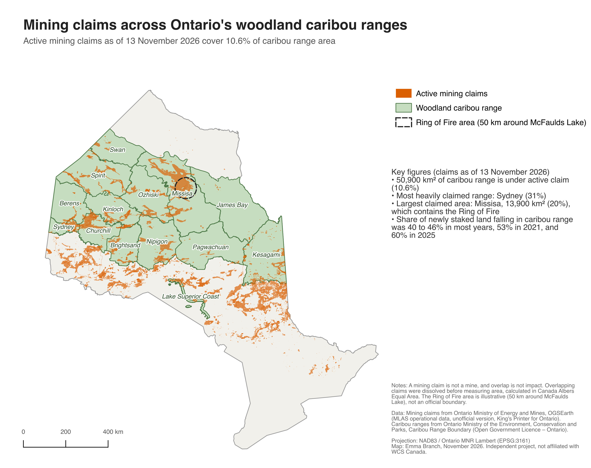
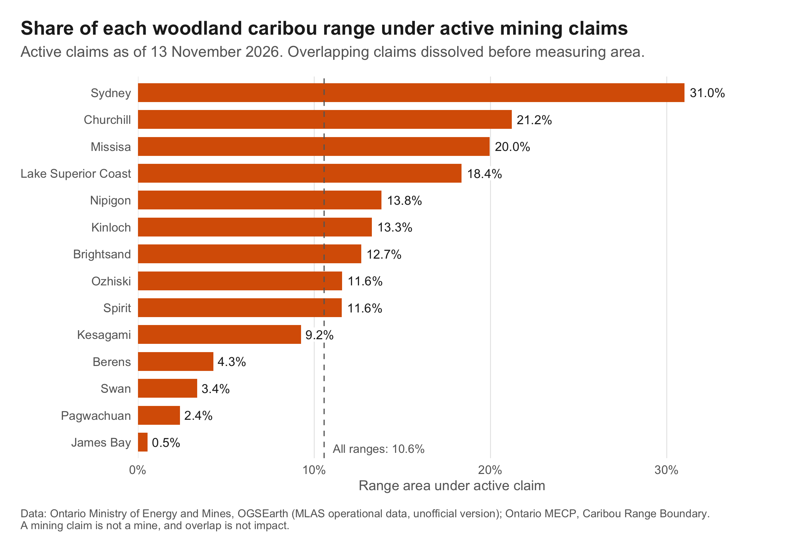
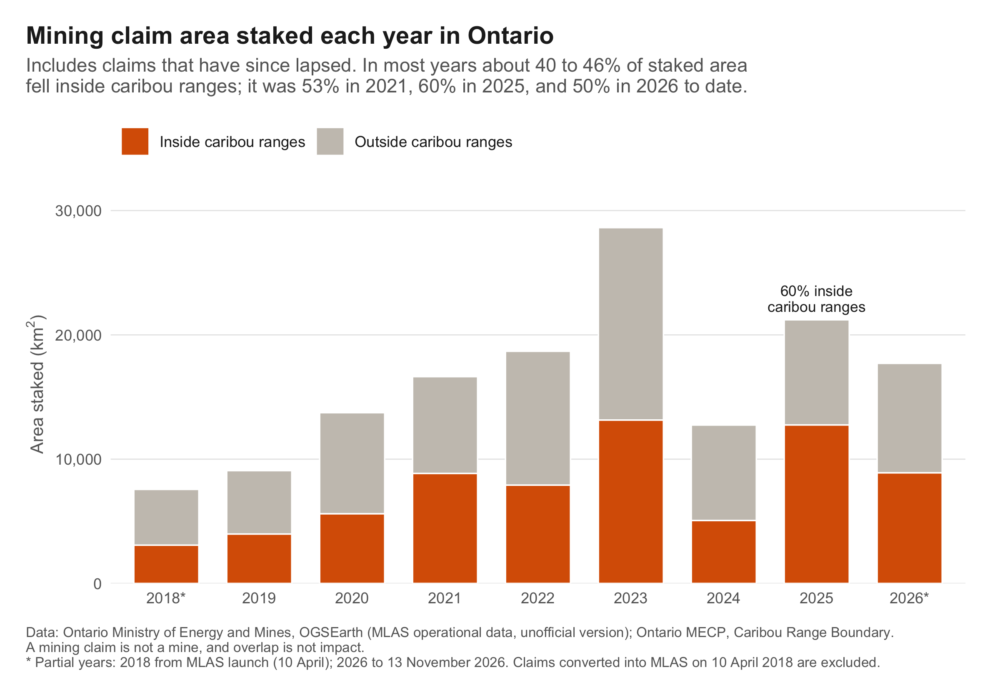

# Mining claims across Ontario's woodland caribou ranges

An automated, reproducible workflow that downloads Ontario's mining claims data, measures how much of each woodland caribou range is covered by active claims, and tracks how claim staking has changed since online staking began in 2018.



> **Independent project.** This is a portfolio project inspired by WCS Canada's Ontario Mineral Tracker. It is not affiliated with, endorsed by, or produced for WCS Canada.

## Questions

1. How much of Ontario's woodland caribou range is covered by active mining claims?
2. How has claim staking changed over time, inside caribou ranges and around the Ring of Fire?

## Key findings (claims as of 13 November 2026)

- **Active mining claims cover about 50,900 km², or 10.6%, of Ontario's woodland caribou ranges.**
- **Sydney** is the most heavily claimed range (31% of its area), followed by Churchill (21%) and Missisa (20%).
- **Missisa**, which contains the Ring of Fire, has the largest claimed area of any range (13,900 km²) and over 72,000 claims.
- Area staked per year rose from about 9,100 km² in 2019 to a **peak of 28,600 km² in 2023**, and remained high in 2025 (21,200 km²) and 2026 to date (17,700 km²).
- In most years, 40 to 46% of newly staked area fell inside caribou ranges. It was **53% in 2021** and **60% in 2025**. Caribou ranges cover roughly 45% of the province, so 2025 staking was concentrated in caribou range more than an even spread would suggest.





Full results: [`outputs/tables/range_overlap.csv`](outputs/tables/range_overlap.csv), [`outputs/tables/staking_by_year.csv`](outputs/tables/staking_by_year.csv), and [`outputs/tables/staking_by_range_year.csv`](outputs/tables/staking_by_range_year.csv).

## Workflow

| Step | Script | Language | What it does |
|---|---|---|---|
| 1 | `python/01_download_data.py` | Python | Scrapes the OGSEarth page for the current claims download links (with fallbacks), downloads and unzips all sources, and logs URL, date, size, and SHA-256 fingerprint |
| 2 | `python/02_prepare_data.py` | Python | Cleans and standardises layers, applies data quality filters, reprojects to an equal-area projection, and writes one GeoPackage plus a prep log |
| 3 | `R/01_load_and_check.R` | R | Checks projections, geometry validity, claim sizes, dates, and range areas |
| 4 | `R/02_overlap_analysis.R` | R | Area and percentage of each caribou range covered by active claims |
| 5 | `R/03_staking_trends.R` | R | Claims and area staked by year, by range, and in the Ring of Fire area |
| 6 | `R/04_figures.R` | R | Publication figures |
| 7 | `qgis/ontario_claims_caribou.qgz` | QGIS | Styled map and print layout |

`python/00_inspect_layers.py` and `python/00_check_claims.py` are exploratory checks that informed the cleaning decisions in step 2.

## Reproducing the analysis

Requirements: [Miniforge](https://github.com/conda-forge/miniforge) (or another conda), R 4.4 or later, and QGIS (LTR) for the map.

```bash
git clone https://github.com/emmabranch/ontario-claims-caribou.git
cd ontario-claims-caribou

# Python: download and prepare data (about 850 MB download)
conda env create -f environment.yml
conda activate claims-caribou
python python/01_download_data.py
python python/02_prepare_data.py

# R: restore package versions, then run the analysis
Rscript -e 'renv::restore()'
Rscript R/01_load_and_check.R
Rscript R/02_overlap_analysis.R
Rscript R/03_staking_trends.R
Rscript R/04_figures.R
```

Raw and processed data are not committed (see `.gitignore`); the scripts recreate them. Claims change daily, so a new run will reflect the claims on the day you download them. Every run appends to `data/raw/download_log.csv`, so results can always be matched to a dated snapshot.

## Data

| Dataset | Publisher | Version used | Licence |
|---|---|---|---|
| Mining claims: MLAS operational GIS data (active cell claims, cancelled claims) | Ontario Ministry of Energy and Mines, Ontario Geological Survey, via [OGSEarth](https://www.geologyontario.mndm.gov.on.ca/ogsearth.html) | Downloaded 13 November 2026 | King's Printer for Ontario. Published as an unofficial version for viewing purposes; official claim information is in the MLAS Map Viewer |
| Administrative boundaries (provincial boundary) | Ontario Ministry of Energy and Mines, via OGSEarth | Downloaded 13 November 2026 | King's Printer for Ontario |
| [Caribou Range Boundary](https://open.canada.ca/data/en/dataset/9edf7410-365a-4197-989f-51cb1634efda) | Ontario Ministry of the Environment, Conservation and Parks | Data folder dated 2019-09-26 | [Open Government Licence – Ontario](https://www.ontario.ca/page/open-government-licence-ontario) |

The Mining Claims Information database listed in the Ontario Data Catalogue was unavailable at the time of this project (marked as under review), so claims were taken from OGSEarth, which the province names as the download source for mining lands GIS data.

## Methods

**Projections.** All areas were calculated in Canada Albers Equal Area Conic (ESRI:102001), which preserves area. The map is displayed in NAD83 / Ontario MNR Lambert (EPSG:3161), the standard projection for provincial maps.

**Active claims.** Taken from `Operational_Cell_Claims` (411,640 claims after cleaning). The separate legacy boundary claims file was not used, because 21,363 of its 21,459 tenure numbers already appear in the cell claims file as Boundary Cell Mining Claims. Four leased tenures were removed.

**Overlap with caribou ranges.** For each range, claims touching the range were found with a spatial index, dissolved into a single footprint (`st_union`) so that overlapping claims are not counted twice, and clipped to the range boundary. The 14 ranges overlap each other by only 0.003 km², so per-range results can be summed.

**Staking trends.** Active and cancelled claims were combined, so claims that have since lapsed still count in the year they were staked. This avoids the survivorship bias of using active claims alone. Each claim was assigned to one range using a point guaranteed to fall inside it (`st_point_on_surface`).

**Data quality.**
- 16 active and 21 cancelled claims had invalid geometry and were repaired with `st_make_valid()`.
- Cancelled claims: the latest revision of each tenure was kept (440,562 rows reduced to 429,894 tenures), then only tenures with status "Cancelled" (amalgamated and merged records are administrative changes, not lapses).
- 1,150 test records (holder names containing "test" or "do not use") were removed.
- Claims with an issue date of 10 April 2018, the date older claims were converted into the online Mining Lands Administration System (MLAS), were excluded from staking trends because that date does not reflect when they were staked (126,914 active claims).
- Holder names were dropped from all processed data and outputs to protect individual prospectors' privacy.

Every filtering step and count is recorded in [`docs/data_prep_log.md`](docs/data_prep_log.md), and QA summaries are in `outputs/tables/qa_*.csv`.

## Limitations

- **A mining claim is not a mine, and overlap is not impact.** A claim gives mineral exploration rights; most claims never lead to a mine. Overlap shows where exploration rights exist in caribou range, not where habitat has been disturbed.
- **Snapshot in time.** Claims are registered, renewed, and cancelled daily. Results describe the claims on the download date only.
- **Unofficial source.** OGSEarth claims data is an unofficial version for viewing purposes; MLAS is the official record.
- **Caribou range data.** The range boundaries are management units from Ontario's Woodland Caribou Recovery Strategy (data version dated 2019). The "Discontinuous Distribution" zone was excluded from the range totals.
- **Staking trends start in 2018.** Staking before the MLAS conversion cannot be dated reliably from this data. 2018 covers 10 April onwards, and 2026 runs to the download date.
- **Staking activity, not footprint.** Land re-staked after a claim lapses counts again in the later year.
- **Ring of Fire area is illustrative.** It is a 50 km radius around McFaulds Lake, not an official boundary.

## Repository structure

```
ontario-claims-caribou/
├── python/             download, preparation, and exploratory check scripts
├── R/                  QA, analysis, and figure scripts
├── qgis/               QGIS project with map layout
├── outputs/
│   ├── maps/           publication map (PNG, PDF)
│   ├── figures/        ggplot2 figures
│   └── tables/         results and QA tables (CSV)
├── docs/               data preparation log
├── data/               raw and processed data (not committed)
├── environment.yml     Python environment
└── renv.lock           R package versions
```

## Tools

Python (geopandas, pyogrio, requests, BeautifulSoup), R (sf, dplyr, ggplot2, renv), QGIS, Git and GitHub. GitHub Copilot were used as coding assistants; all code was reviewed, run, and checked by the author.

## Licence

Code is released under the [MIT Licence](LICENSE.md). Data remain under their original licences listed above.

## Author

Emma Branch ([github.com/emmabranch](https://github.com/emmabranch)), November 2026.
