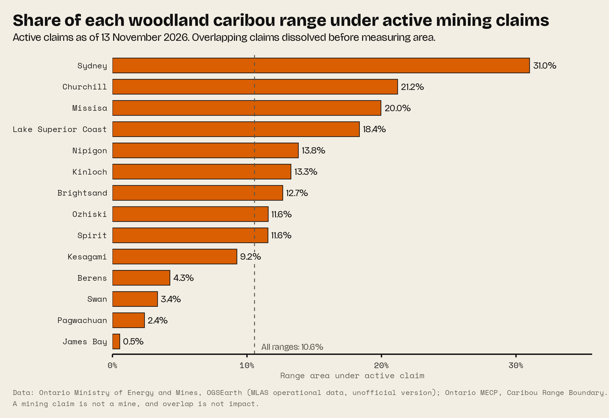
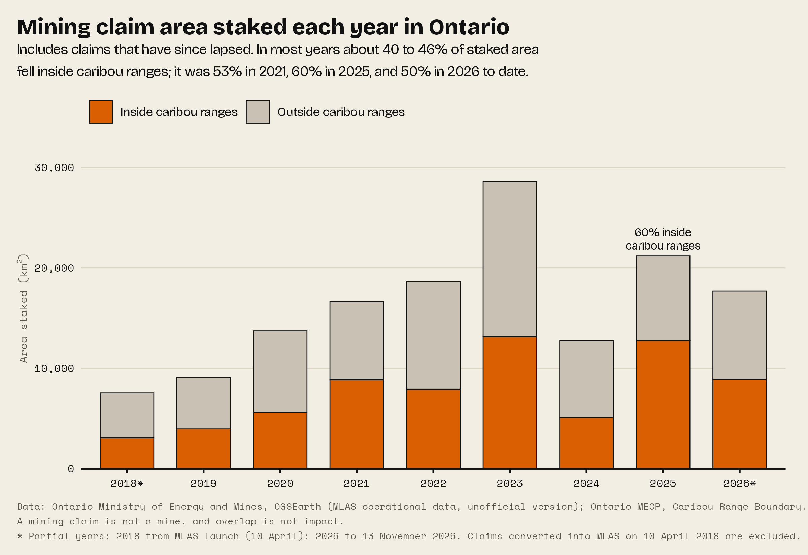

```{r}
#| label: setup
library(dplyr)
library(readr)
library(sf)
library(leaflet)
library(here)

overlap <- read_csv(here("outputs", "tables", "range_overlap.csv"), show_col_types = FALSE)
by_year <- read_csv(here("outputs", "tables", "staking_by_year.csv"), show_col_types = FALSE)

all_ranges <- filter(overlap, range_name == "All ranges")
top_range  <- overlap |> filter(range_name != "All ranges") |> slice_max(pct_claimed, n = 1)
as_of      <- as.Date(overlap$claims_as_of[1])
as_of_txt  <- paste(as.integer(format(as_of, "%d")), format(as_of, "%B %Y"))
pct_2025   <- by_year |> filter(issue_year == 2025) |> pull(pct_area_in_ranges)

fmt_num <- function(x, round_to = 0) format(round(x, round_to), big.mark = ",", trim = TRUE)
```

```{r}
#| label: hero-stripes
#| include: false
# Hero background: one stripe per year, brighter where a larger share of
# newly staked land fell inside caribou range
yrs <- arrange(by_year, issue_year)
stripe_pal <- colorNumeric(c("#3b2a12", "#94661a", "#f0c674"),
                           domain = range(yrs$pct_area_in_ranges, na.rm = TRUE),
                           na.color = "#3b2a12")
n_yrs <- nrow(yrs)
w <- 1000 / n_yrs
stripe_rects <- sprintf('<rect x="%.2f" y="0" width="%.2f" height="26" fill="%s"></rect>',
                        (seq_len(n_yrs) - 1) * w, w + 0.6, stripe_pal(yrs$pct_area_in_ranges))
stripes_html <- paste0('<div class="hero-bg"><svg viewBox="0 0 1000 26" preserveAspectRatio="none" aria-hidden="true">',
                       paste(stripe_rects, collapse = ""), '</svg></div>')
```

::::: {.hero-full .column-screen}

```{=html}

```

```{r}
#| label: hero-bg
#| output: asis
cat(stripes_html)
```

:::: {.hero-inner}

[Independent portfolio project · Python · R · QGIS · open data]{.eyebrow}

# How much of Ontario's caribou range is staked for [mining]{.accent}?

Active mining claims cover `r round(all_ranges$pct_claimed, 1)`% of Ontario's woodland caribou ranges, as of `r as_of_txt`. This project downloads the province's claims data automatically, measures the overlap with each of the 14 ranges, and tracks how claim staking has changed since Ontario moved registration online in 2018.

[Explore the ranges](#explore-the-ranges){.btn .btn-accent} [Methods and data](methods.qmd){.btn .btn-ghost} [Code on GitHub](https://github.com/emmabranch/ontario-claims-caribou){.btn .btn-ghost}

[Background: one stripe per year since `r min(yrs$issue_year)`, brighter where a larger share of newly staked land fell inside caribou range. The latest year runs to `r as_of_txt`.]{.hero-note}

::::

:::::

:::: {.stat-row .lift}
::: {.stat-box}
[`r round(all_ranges$pct_claimed, 1)`%]{.num}

[of caribou range under active claim]{.lab}
:::

::: {.stat-box}
[`r fmt_num(all_ranges$claimed_km2, -2)`]{.num}

[km² claimed, nearly the size of Nova Scotia]{.lab}
:::

::: {.stat-box}
[`r round(top_range$pct_claimed)`%]{.num}

[of the `r top_range$range_name` range, the most heavily claimed]{.lab}
:::

::: {.stat-box}
[`r round(pct_2025)`%]{.num}

[of land staked in 2025 fell inside caribou range]{.lab}
:::
::::

::: {.disclaimer}
A mining claim is not a mine, and overlap is not impact. A claim gives the right to explore for minerals, and most claims never lead to a mine. These figures show where exploration rights exist in caribou range, not where habitat has been disturbed.
:::

## Explore the ranges

Click a range to see how much of it is under active claim. The dashed circle marks an illustrative Ring of Fire area (50 km around McFaulds Lake), not an official boundary.

```{r}
#| label: range-map
gpkg <- here("data", "processed", "claims_caribou.gpkg")

ranges <- st_read(gpkg, layer = "caribou_ranges", quiet = TRUE) |>
  st_make_valid() |>
  st_simplify(dTolerance = 500, preserveTopology = TRUE) |>   # lighter web map
  st_transform(4326) |>
  left_join(overlap, by = "range_name")

ring_of_fire <- st_read(gpkg, layer = "ring_of_fire_area", quiet = TRUE) |>
  st_transform(4326)

pal <- colorBin(
  palette = c("#fde0c5", "#f9b98a", "#f08a4b", "#d95f02", "#8c3a00"),
  domain  = ranges$pct_claimed,
  bins    = c(0, 5, 10, 15, 20, 35)
)

popups <- sprintf(
  "<strong>%s</strong><br>%.1f%% of range under active claim<br>%s km² claimed of %s km²<br>%s claims touch this range",
  ranges$range_name, ranges$pct_claimed,
  fmt_num(ranges$claimed_km2), fmt_num(ranges$range_km2),
  fmt_num(ranges$claims_touching)
)

leaflet(ranges, height = 560) |>
  addProviderTiles(providers$Esri.WorldGrayCanvas) |>
  addPolygons(
    fillColor = ~pal(pct_claimed), fillOpacity = 0.8,
    color = "#2f5d3f", weight = 1,
    label = ~sprintf("%s: %.1f%% claimed", range_name, pct_claimed),
    popup = popups,
    highlightOptions = highlightOptions(weight = 3, color = "#14261c", bringToFront = TRUE)
  ) |>
  addPolygons(
    data = ring_of_fire, fill = FALSE, color = "#222222", weight = 2, dashArray = "6 6",
    label = "Ring of Fire area (illustrative)"
  ) |>
  addLegend(
    pal = pal, values = ~pct_claimed, position = "bottomright",
    title = "Range area<br>under claim", labFormat = labelFormat(suffix = "%")
  )
```

## The map

Every active claim, drawn without outlines so 411,000 claims read as a single footprint. Claims cluster around the Ring of Fire, along the southern edge of the ranges, and in the northeast.


[Download the map as a PDF](outputs/maps/ontario_claims_caribou_map.pdf)

## Which ranges are most claimed?

The `r top_range$range_name` range has the highest share under claim. Missisa, which contains the Ring of Fire, has the largest claimed area of any range.

{fig-alt="Bar chart of the share of each caribou range under active claim, from Sydney at 31% to James Bay at 0.5%."}

## How has staking changed?

Counting claims that have since lapsed as well as active ones, area staked per year peaked in 2023. In most years about 40 to 46% of staked land fell inside caribou range, rising to 53% in 2021 and `r round(pct_2025)`% in 2025.

{fig-alt="Stacked bar chart of area staked per year, inside and outside caribou ranges, 2018 to 2026."}

## About this project

An independent portfolio project inspired by WCS Canada's Ontario Mineral Tracker. It is not affiliated with, endorsed by, or produced for WCS Canada. See [Methods and data](methods.qmd) for sources, licences, processing decisions, and limitations, or the [code on GitHub](https://github.com/emmabranch/ontario-claims-caribou).
